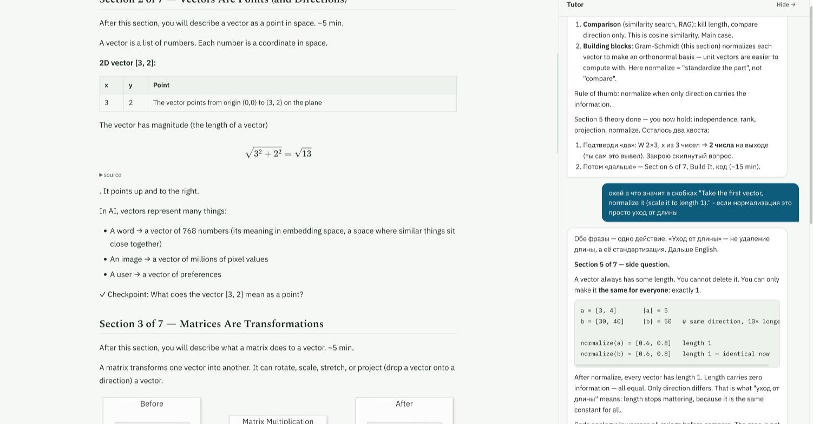

# Body Double

A self-hosted AI tutor built for ADHD brains.

[](https://github.com/kurkul608/body-double/actions/workflows/ci.yml)
[](LICENSE)
[](https://github.com/kurkul608/body-double/releases)
[](https://nodejs.org/)

**What:** a chat tutor for the open course [AI Engineering from Scratch](https://github.com/rohitg00/ai-engineering-from-scratch), one lesson at a time.<br>
**Who:** learners with ADHD, including non-native English speakers.<br>
**Run:** `pnpm install && pnpm sync && pnpm dev` with your own Anthropic API key (see [Quickstart](#quickstart)).

## Why Body Double

Body doubling is an ADHD technique: another person's presence helps you stay on task.
This tutor plays that role while you learn.
It stays with you through each lesson, tracks where you are, and tells you the next small step.

## Features

- **ADHD format:** point first, short messages, numbered steps, time estimates.
- **Simple English:** at your level, with help in your native language.
- **Adapted lessons:** rewritten on first open, with a checkpoint per section.
- **Practice:** skippable question cards, lesson quizzes, a glossary.
- **Memory:** lesson summaries and local search over past chats.
- **Local data:** SQLite, synced with your `LEARNING.md`.



## Quickstart

Status: early beta (0.x). Expect breaking changes between minor versions.

Requirements: Node.js 26 or newer, [pnpm](https://pnpm.io/) 12 or newer, and an Anthropic API key.

1. Install dependencies.

   ```bash
   pnpm install
   ```

2. Create your config and set `ANTHROPIC_API_KEY` in `.env`.

   ```bash
   cp .env.example .env
   ```

3. Create your learner profile and edit it (see [Learner profile](#learner-profile)).

   ```bash
   cp profile/LEARNING.example.md profile/LEARNING.md
   ```

4. Pull the course outline.

   ```bash
   pnpm sync
   ```

5. Start the API (port 3111) and the Vite client, then open the Vite URL it prints.

   ```bash
   pnpm dev
   ```

There is no production `start` command yet. The first chat message downloads a small embedding model.

## Deploy with Docker

Run it on a server with Docker and the Compose plugin.

1. Create `.env` and your profile, as in Quickstart steps 2 and 3.

2. Give the container user (uid 1000) write access.

   ```bash
   mkdir -p data && sudo chown -R 1000:1000 data profile
   ```

3. Build and start.

   ```bash
   docker compose up -d --build
   ```

4. Pull the course outline.

   ```bash
   docker compose exec server node dist/cli/sync.js
   ```

5. Open `http://localhost:8080` on the same host. Set `WEB_PORT` to use another port.

Data stays on the host in `data/` and `profile/`.
The app has no login, and anyone who reaches it spends your Anthropic key. Port 8080 binds to `127.0.0.1` for that reason. To reach it from other machines, put a reverse proxy (Caddy, Traefik, nginx) with authentication and TLS in front of it.

## Configuration

All settings live in `.env`. The template is `.env.example`.

| Variable | Default | Meaning |
|---|---|---|
| `ANTHROPIC_API_KEY` | (none) | Your key from [console.anthropic.com](https://console.anthropic.com/). Required. |
| `TUTOR_MODEL` | `opus` | Model for the tutor chat. |
| `UTIL_MODEL` | `sonnet` | Model for lesson rewrites and summaries. |
| `PORT` | `3111` | Port of the API server. |
| `HOST` | `127.0.0.1` | Bind address of the API server. Docker sets `0.0.0.0`. |

**Models.** Use an alias (`opus`, `sonnet`, `haiku`: the latest model the installed SDK knows) or a full model ID to pin one version.

**Cost.** You pay Anthropic for API usage.
Each message sends the system prompt, your profile, the lesson text, and the lesson's chat history.
Each lesson also runs one rewrite and one summary with `UTIL_MODEL`.
For a cheaper tutor, set `TUTOR_MODEL=sonnet` ([pricing](https://www.anthropic.com/pricing)).

## Learner profile

`profile/LEARNING.md` tells the tutor who you are. The tutor reads it on every message. It is gitignored.

Front matter:

| Field | Default | Used for |
|---|---|---|
| `name` | `the learner` | How the tutor addresses you. |
| `native_language` | `English` | Language for help and glossary notes. |
| `english_level` | `B2` | Level of the simple English. |

The rest is free text (background, goals, neuro profile) plus two tables. Keep their headings and columns as in the example:

- `## Path`: a status (`Do`, `Review`, `Skip`, `Done`) and hours per phase. `pnpm sync` reads it.
- `## Progress log`: the app appends one row per finished lesson.

The profile is optional. Without it, the tutor uses the defaults and progress lives only in the database.

## Updating

Local install:

```bash
git pull && pnpm install && pnpm sync
```

Docker:

```bash
git pull && docker compose up -d --build
```

`pnpm sync` is safe to re-run: it updates the outline and re-reads your Path table.

## Troubleshooting

- **"Model X is not available for your API key."**<br>
  Change the variable the message names (`TUTOR_MODEL` or `UTIL_MODEL`) in `.env`, then restart.
- **No phases or lessons on screen.**<br>
  Run `pnpm sync` (Docker: [Deploy](#deploy-with-docker) step 5).
- **Port 3111 is busy.**<br>
  Set `PORT` in `.env`. The server and the Vite proxy both read it.
- **Docker: permission errors on `data/` or `profile/`.**<br>
  Run [Deploy](#deploy-with-docker) step 3, then `docker compose restart server`.

## Architecture

```
 Browser (Vite + React)
        |  HTTP + SSE (/api)
        v
 Server (Fastify, HOST:PORT)
   |-- Tutor: Claude Agent SDK + in-process MCP tools  --> Anthropic API
   |-- SQLite (better-sqlite3): data/learn.db
   |-- RAG: transformers.js embeddings, local
   |-- Content sync  --> raw.githubusercontent.com (course repo)
   '-- profile/LEARNING.md (read + append)
```

- **Server** (`server/`): Fastify, better-sqlite3, and a Claude Agent SDK agent with 4 MCP tools (`ask_question`, `add_glossary_term`, `search_history`, `mark_lesson_done`). Embeddings: `Xenova/all-MiniLM-L6-v2`, cosine search.
- **Client** (`client/`): Vite, React, Tailwind, KaTeX, Mermaid.
- **Content**: fetched at runtime from the course repository and cached locally. Not included in this repository.

The server/client API contract is in [`SPEC.md`](SPEC.md).

## Limitations

1. One learner per install, with no accounts or login. Locally the server listens on `127.0.0.1` only. Docker publishes port 8080 on `127.0.0.1` too, with no authentication; add it in a reverse proxy.
2. Only one course is supported for now: AI Engineering from Scratch.
3. You need an Anthropic API key, and API usage is paid.
4. Data is stored locally, but chat content goes to the Anthropic API.

## Contributing

Open an issue first for larger changes.
Setup, checks, commit rules, and the release process are in [`CONTRIBUTING.md`](CONTRIBUTING.md).

## License and credits

Body Double is released under the MIT License. See [`LICENSE`](LICENSE) and
[`THIRD_PARTY_NOTICES.md`](THIRD_PARTY_NOTICES.md).

- Course: [AI Engineering from Scratch](https://github.com/rohitg00/ai-engineering-from-scratch)
  by Rohit Ghumare (MIT). Fetched at runtime, not included.
- Skill [`i-have-adhd`](https://github.com/ayghri/i-have-adhd) by Ayoub Ghriss
  (MIT), included unchanged in `skills/`.
- Skill [`simple-english`](https://github.com/aminblg/simpleenglish) by AminBlg
  (MIT), included unchanged in `skills/`.
